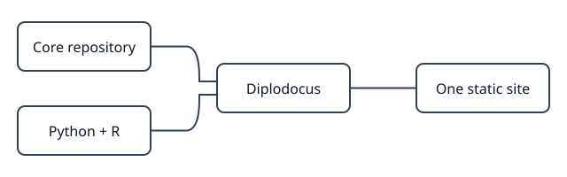

# Overview

Diplodocus builds documentation sites for Python, R, Julia, Rust, and C++ packages.
It combines guides you write with API references extracted from your packages,
with shared navigation, cross-references, and search. You can document a single
package or bring several related packages together on one site.

## How a project fits together

A `diplodocus.yaml` file describes your site. It names the repositories that
contain your sources, the packages whose APIs you want to document, and the
collections of Markdown pages you want to publish. A collection is a directory
or an individual file, such as a guide or changelog.



You can start with Markdown alone and add packages later. For API extraction,
prepare each package's language runtime and dependencies before building.
Diplodocus reads the declared sources and uses native tools to resolve APIs and
verify executable examples.

## Build your first site

The [getting started tutorial](quick-start.md) takes you from an empty directory
to a local preview. Follow [installation](installation.md) first if you need the
CLI. The usual workflow is:

```console
diplodocus check
diplodocus serve
diplodocus build
```

`check` validates your sources and links. `serve` builds the site, watches your
files, and rebuilds when they change. `build` writes a static site for publishing.

## Grow your documentation

Use the **Authoring** section to [configure your project](configuration.md),
[write pages](authoring.md), [arrange navigation](navigation.md), and
[customize the site's appearance](presentation.md). Add
[executable examples](execution.md) when you want to publish results alongside
the code that produced them.

Use the **Extraction** section to add API documentation for
[Python](extraction/python.md), [R](extraction/r.md),
[Julia](extraction/julia.md), or [Rust](extraction/rust.md).
Each language guide describes its inputs, environment, and supported examples.

The [CLI Reference](../reference/cli.md) and
[configuration reference](../reference/configuration.md) provide the full
option lists. The **Advanced** section covers troubleshooting, portable
snapshots, and custom browser components when you need them.
