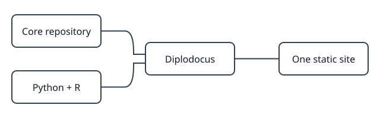

# Guide

Diplodocus builds one site for related Python, R, Julia, and Rust packages. It
combines extracted API references with authored guides, shared
navigation, cross-references, and search. This guide is built by Diplodocus from
the project's own `diplodocus.yaml`.

Start with [installation](installation.md) and the [quick
start](quick-start.md). Then configure your [workspace](configuration.md), write
[authored pages](authoring.md), and use the [command reference](../reference/cli.md) as you
build. The [executable example](../examples/stateful.qmd) shows a Python QMD
page built with the project's configured kernel.

Language adapters use source analysis and native tools to resolve APIs and
verify executable examples. Rust uses a separately pinned nightly compiler.
Read the [extraction guide](extraction.md) for the supported surfaces, the
[execution guide](execution.md) before enabling QMD cells, and the [diagnostics
guide](diagnostics.md) when a build reports a problem. A [portable SQLite
snapshot](snapshots.md) lets you generate the site separately from extraction.
