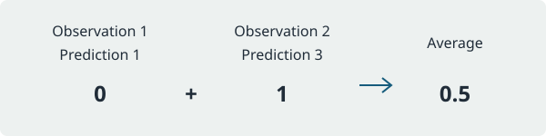

# Tiny Stats for R

Tiny Stats provides six small functions for comparing predictions with observed
values. Use error magnitudes to measure accuracy, mean error to inspect bias,
and residuals to see which predictions need attention.

## Installation

From the Diplodocus repository root, install the example package:

```r
install.packages("examples/monorepo/r", repos = NULL, type = "source")
```

## Compare predictions

```r
library(tinystats)

observed <- c(1, 2, 3, 4)
predicted <- c(1, 2, 3, 6)
mean_squared_error(observed, predicted)
# [1] 1
mean_absolute_error(observed, predicted)
# [1] 0.5
```

[`mean_squared_error`] gives larger errors more weight, while
[`mean_absolute_error`] measures the typical absolute difference.



Read the [shared metric guide](../docs/guides/choosing-a-metric.md) to choose a
score, or inspect [`residuals`] to examine individual errors.

The [R vignette](vignettes/evaluating-predictions.Rmd) walks through computed
scores and a residual plot. Diplodocus discovers it automatically and runs its R
chunks when extracting the documentation.

## Package information

See the [release notes](NEWS.md), [citation](inst/CITATION),
[license](LICENSE.md), and [contribution guidelines](CONTRIBUTING.md).
